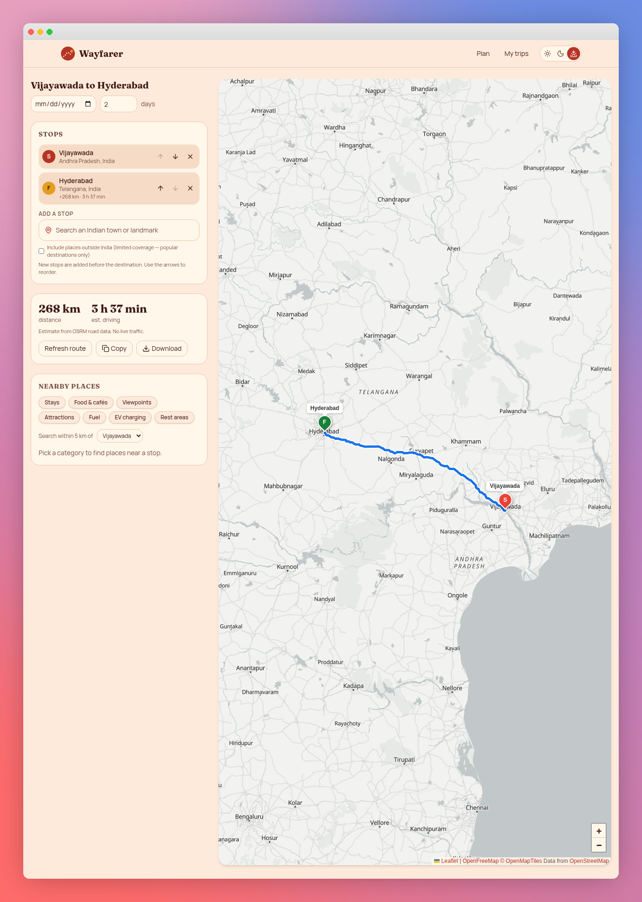

<p align="center">
  
</p>

<h1 align="center">Wayfarer</h1>
<p align="center"><strong>India-first road trip planner</strong><br />Find places. Plan stops. Take the long way round.</p>

<p align="center">
  
  
  
  
  
</p>


## About the project

Wayfarer helps users plan driving trips, primarily within India. Search for a starting place and destination, see a route on an interactive map, and add stops along the way. Explore nearby hotels, restaurants, fuel stations, and attractions around a selected stop.

It uses open map data and free public services. No sign-up, database setup, or API keys are required for the current features. An internet connection is required for maps, search, routes, and nearby places.

> **Important:** Saved trips stay in the browser and device where they were created. They do not automatically appear on another laptop or phone.

## Features

- **India-first search:** Place-name suggestions as you type, with state information when available.
- **Optional international search:** Include places outside India; coverage varies.
- **Interactive map:** OpenFreeMap background, labeled stops, and a driving route.
- **Editable stops:** Add, reorder, and remove places.
- **Route estimates:** Driving distance and estimated travel time—not live traffic.
- **Nearby places:** Stays, food & cafés, viewpoints, attractions, fuel, EV charging, and rest areas within 5 km of a selected stop, where data is available.
- **Trip details:** Optional start date and an editable, clearable days field.
- **Browser-local saving:** Reopen and delete trips from My trips.
- **Itinerary export:** Copy or download a plain-text `.txt` itinerary.
- **Three themes:** Sunset by default, plus Daylight and Dusk.
- **Phone and laptop layouts:** Use the app in a modern web browser.

## Route-planning preview



*Example trip shown for illustration; distances and times depend on the routing service.*

## Quick start

### 1. Install Node.js

Install **Node.js 22.12 or newer in the 22.x LTS line**, or a newer supported LTS release, from [nodejs.org](https://nodejs.org/). npm is included.

Check the installation in PowerShell or Terminal:

```bash
node --version
npm --version
```

### 2. Download this repository

On GitHub, choose **Code → Download ZIP**, then extract it. Open a terminal inside the extracted app folder—the one containing `package.json`.

> If the ZIP creates a folder inside another folder, enter the inner folder first. The correct folder contains `package.json`, `src`, and `vite.config.ts`.

### 3. Install and start

```bash
npm install
npm run dev -- --open
```

The second command starts the app and opens your browser automatically. Use the **Local** address printed in the terminal; in the supplied setup it is normally `http://localhost:8080`.

Keep the terminal running while using the app. Press **Ctrl+C** to stop it.

### Start it again later

You normally only need:

```bash
npm run dev -- --open
```

Run `npm install` again if dependencies change or you download a new version.

## Open it on a phone

For testing on your own Wi-Fi:

1. Connect the laptop and phone to the same Wi-Fi network.
2. Start the app with:

   ```bash
   npm run dev -- --host 0.0.0.0 --open
   ```

3. Open the **Network** address shown in the terminal on your phone—for example, `http://192.168.1.112:8080`.
4. If Windows asks about network access, allow it on your trusted **private** network only.

The example IP is not permanent; use your own current Network address. `localhost` on a phone refers to the phone, not your laptop. This Wi-Fi address is not a public internet link.

## How to use it

1. Enter a starting place and destination, choosing a suggestion for each.
2. Add a date or number of days if needed, then create the trip.
3. Add or reorder stops on the trip page.
4. Select a nearby-place category and the stop to search around.
5. Select a returned place to highlight it on the map.
6. Use **Copy** or **Download** to share the itinerary text.
7. Open **My trips** in the same browser to return to saved trips.

## Technology

| Part | Technology |
|---|---|
| User interface | React 19 and TypeScript |
| Pages and application framework | TanStack Router and TanStack Start |
| Styling | Tailwind CSS 4 and Radix-based UI controls |
| Development and bundling | Vite |
| Map rendering | Leaflet, MapLibre GL, and the MapLibre–Leaflet bridge |
| Saved trips | Browser `localStorage` |
| Automated tests | Vitest |

## Map and place services

| Service | What it provides |
|---|---|
| [OpenFreeMap](https://openfreemap.org/) | The map background |
| [OpenStreetMap](https://www.openstreetmap.org/copyright) | Community-maintained geographic data |
| [Photon](https://photon.komoot.io/) | Place-name autocomplete |
| [Nominatim](https://nominatim.org/) | Backup place search and nearby-category search |
| [OSRM](https://project-osrm.org/) | Driving routes, distance, and duration estimates |
| [Overpass API](https://wiki.openstreetmap.org/wiki/Overpass_API) | Nearby places from OpenStreetMap data |

No keys are needed for the public endpoints currently used. These are separate services: free access does **not** guarantee permanent availability or unlimited production use. Respect provider usage policies; a high-traffic deployment may need dedicated or self-hosted services.

Search terms and coordinates are sent to these providers to produce results. Saved trip records remain in the browser; they are not synced to a Wayfarer account.

## Project structure

```text
src/
  assets/                 Homepage image
  components/             Search boxes, header, and interactive map
  lib/
    geo.ts                Place search, routing, and nearby lookups
    trips.ts              Trip saving and itinerary formatting
  routes/
    __root.tsx            Shared page shell
    index.tsx             Trip-planning homepage
    trips.tsx             Saved trips
    trip.$id.tsx          Individual trip editor and map
  styles.css              Shared styles and theme colours
public/                   Public files
vite.config.ts            Development and build configuration
package.json              Dependencies and commands
```

## Commands and testing

| Command | Purpose |
|---|---|
| `npm run dev -- --open` | Start development and open the browser |
| `npm run build` | Create a production build |
| `npm run preview` | Preview the build locally |
| `npm test` | Run automated tests |
| `npm run lint` | Check code quality |

The current targeted suite contains **6 tests across 3 files**, covering route-file setup, trip storage/reordering, and nearby-search fallback, cancellation, and malformed/out-of-radius results. It is not a complete guarantee that every feature or public provider will always work.

## Put the code on GitHub manually

See [MANUAL_GITHUB_GUIDE.md](MANUAL_GITHUB_GUIDE.md) for step-by-step browser-upload instructions. No Git commands are required for that method.

**Uploading code is not the same as publishing a working website.** People can download a GitHub repository and run it locally. To let visitors open the app without installing anything, deploy it to a compatible host and share that host's public link.

### Hosting note

This is a **TanStack Start application with a server build**, not simply an HTML folder. Its current configuration targets Cloudflare through Nitro. Do not enable GitHub Pages and expect this source code to run there unchanged.

Use a compatible Cloudflare Workers deployment workflow for the production build. A different host may require changing the deployment target. Hosting needs its own setup; this README does not claim a particular deployment has been verified.

## Limits and troubleshooting

| Situation | What to do |
|---|---|
| `Missing script: dev` | Open the folder containing the app's `package.json`, then run the command again. |
| Browser did not open | Open the terminal's Local address, or press `o` then Enter in Vite. |
| Phone cannot connect | Check the same Wi-Fi, Network address, laptop server, and private-network firewall permission. |
| Search or nearby results are empty | Check internet access, try a clearer name or another category, and retry later. Public data may be incomplete. |
| A route cannot be found | Check stop locations. Some places are not connected by a routable driving network. |
| A trip is missing on another device | Expected: trips are browser-local. Share the downloaded itinerary text instead. |
| Trips disappeared after clearing browser data | Browser storage was removed. Keep exported itineraries as backups. |
| npm reports security warnings | Review them rather than ignoring them. Do not blindly run `npm audit fix --force`; it can introduce incompatible upgrades. |

International coverage is limited, nearby results are not exhaustive, and travel times do not account for live traffic or road closures. This is a trip-planning tool, not turn-by-turn navigation, booking, or an emergency service.

## Credits

Created as a road-trip planning project for a MentorMind Menternship. Map data © OpenStreetMap contributors; map rendering and place services are credited above. Keep the map's attribution visible when adapting the project.

No open-source license is included at present. A public repository allows viewing and downloading; it does not automatically grant unrestricted reuse. Add a license if you choose to permit reuse.
# wayfarer

