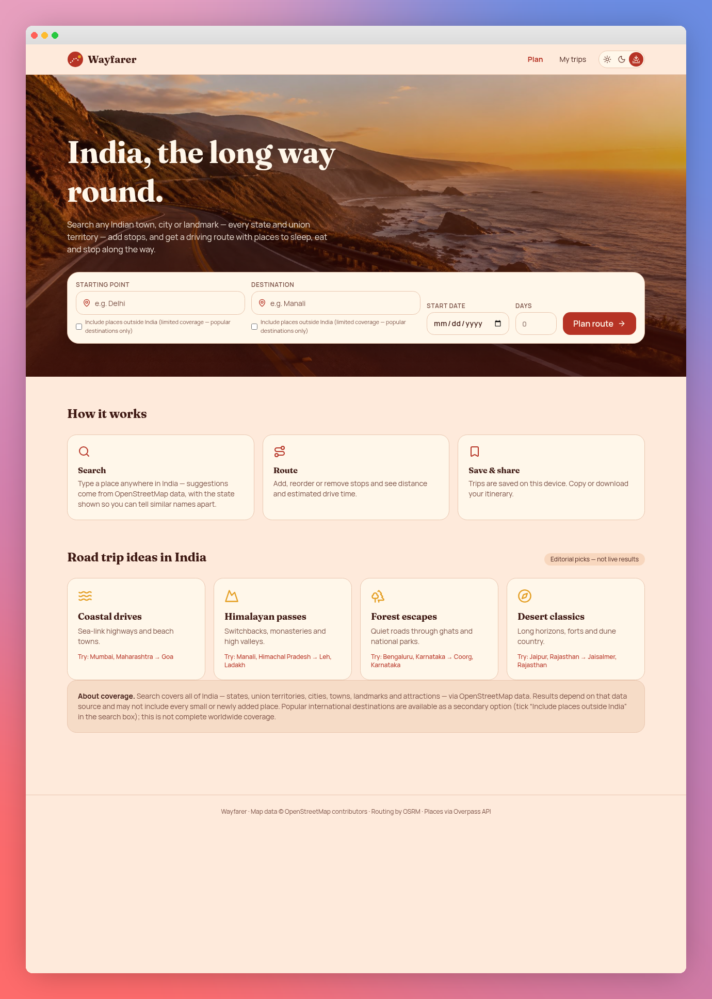

# Wayfarer

**An India-first road trip planner**\
*Find places. Plan stops. Take the long way round.*
### [🚀 Live  — Try Wayfarer](https://wayfarer-green-seven.vercel.app/)




## Overview

Wayfarer helps you plan driving trips, primarily in India. Search for a
starting point and destination, view the route on an interactive map,
and add stops along the way. You can also explore nearby stays,
restaurants, fuel stations, and attractions around selected stops.

-   No account or API key is required for the currently implemented
    public services.
-   An internet connection is required for place search, maps, routes,
    and nearby results.
-   Trips are saved in the browser and device where you created them;
    they are not synced between devices.

## Features

-   **Place search:** Type-ahead suggestions, with India-first search
    and optional international coverage.
-   **Interactive route map:** View the driving route and trip stops on
    a map.
-   **Flexible itinerary:** Add, reorder, and remove stops.
-   **Route estimates:** Estimated driving distance and duration; live
    traffic is not included.
-   **Nearby places:** Find food, cafés, stays, attractions, viewpoints,
    fuel, EV charging, and rest areas near a selected stop when data is
    available.
-   **Trip details:** Optionally set a start date and trip duration.
-   **Saved trips:** Reopen or delete trips in the same browser.
-   **Export:** Copy or download an itinerary as plain text.
-   **Themes and responsive layout:** Choose Sunset, Daylight, or Dusk
    on laptop or phone.

## Route-planning preview


*Example trip shown for illustration. Routes, distances, durations, and
nearby results depend on public services and available data.*

## Getting started

### Requirements

-   [Node.js](https://nodejs.org/) 22.12 or a newer supported LTS
    release
-   npm
-   Internet access for map and place services

Check your installation:

``` bash
node --version
npm --version
```

### Install and run

1.  Clone the repository or download and extract the ZIP.
2.  Open a terminal in the project folder containing `package.json`.
3.  Install dependencies and start the development server:

``` bash
npm install
npm run dev -- --open
```

Vite prints the local address in the terminal and attempts to open it in
your browser. In this setup, the address is usually
`http://localhost:8080/`.

Keep the terminal open while using the app. Press `Ctrl+C` to stop the
server. To start it again later, run:

``` bash
npm run dev -- --open
```

## How to use Wayfarer

1.  Enter a starting place and destination, then choose a suggestion for
    each.
2.  Create the trip; add a date or duration if needed.
3.  Add, reorder, or remove stops on the trip page.
4.  Choose a nearby-place category and the stop you want to explore.
5.  Select a result to highlight it on the map.
6.  Copy or download the itinerary.
7.  Open **My trips** in the same browser to return to saved trips.

### Test on a phone over Wi-Fi

Connect your phone and laptop to the same trusted Wi-Fi network, then
run:

``` bash
npm run dev -- --host 0.0.0.0 --open
```

Open the **Network** address printed by Vite on your phone. If Windows
asks, allow access only on a trusted private network. This is for local
Wi-Fi testing, not a public website link.

## Tech stack

  Area                                Technology
  ----------------------------------- ----------------------------------------
  UI                                  React 19, TypeScript
  Application framework and routing   TanStack Start, TanStack Router
  Styling and UI components           Tailwind CSS 4, Radix-based components
  Development and bundling            Vite
  Mapping                             Leaflet, MapLibre GL
  Trip storage                        Browser `localStorage`
  Tests                               Vitest

## Map and place services

  ----------------------------------------------------------------------------------------------
  Service                                                    Purpose
  ---------------------------------------------------------- -----------------------------------
  [OpenFreeMap](https://openfreemap.org/)                    Map background

  [OpenStreetMap](https://www.openstreetmap.org/copyright)   Community-maintained map data

  [Photon](https://photon.komoot.io/)                        Place-name suggestions

  [Nominatim](https://nominatim.org/)                        Backup place search and
                                                             nearby-category search

  [OSRM](https://project-osrm.org/)                          Driving route, distance, and
                                                             duration estimates

  [Overpass                                                  Nearby places from OpenStreetMap
  API](https://wiki.openstreetmap.org/wiki/Overpass_API)     data
  ----------------------------------------------------------------------------------------------

These public services do not require keys in the current setup, but
availability, coverage, rate limits, and usage policies can change.
Search terms and coordinates are sent to the relevant providers to
retrieve results. A production deployment with significant traffic may
need dedicated or self-hosted services.

## Useful commands

  Command                   Purpose
  ------------------------- ------------------------------
  `npm run dev -- --open`   Start the development server
  `npm run build`           Create a production build
  `npm run preview`         Preview the build locally
  `npm test`                Run automated tests
  `npm run lint`            Check code quality

## Project structure

``` text
src/
├── assets/       Homepage imagery
├── components/   Search, header, map, and UI components
├── hooks/        Reusable React hooks
├── lib/          Place search, routing, trip storage, utilities
└── routes/       Homepage, saved trips, and trip editor
public/           Public assets
docs/images/      README screenshots and logo
package.json      Dependencies and scripts
vite.config.ts    Vite and framework configuration
```

## Notes and limitations

-   **Browser-local storage:** Saved trips stay on the device and
    browser where they were created. Clearing browser data may remove
    them, so export important itineraries as backups.
-   **Route estimates:** Durations are estimates, not live traffic
    predictions. Some locations may not connect to a routable road.
-   **Public data:** International coverage and nearby-place results
    vary and may be incomplete.
-   **Not a navigation or booking service:** Wayfarer does not provide
    turn-by-turn navigation, reservations, or emergency assistance.
-   **Deployment:** This is a TanStack Start application with a server
    build, not just a static HTML folder. The repository's configuration
    targets Cloudflare through Nitro. GitHub Pages will not run it
    unchanged; use a compatible deployment workflow and verify the
    production build and host configuration before publishing.

## Credits

Created as a road-trip planning project for a MentorMind Menternship.
Map data is provided by OpenStreetMap contributors, with map rendering
and place services listed above. Keep required map attribution visible
when adapting the project.

No open-source license is currently included. Public visibility on
GitHub does not, by itself, grant permission for unrestricted reuse; add
a license if you want to permit reuse.
